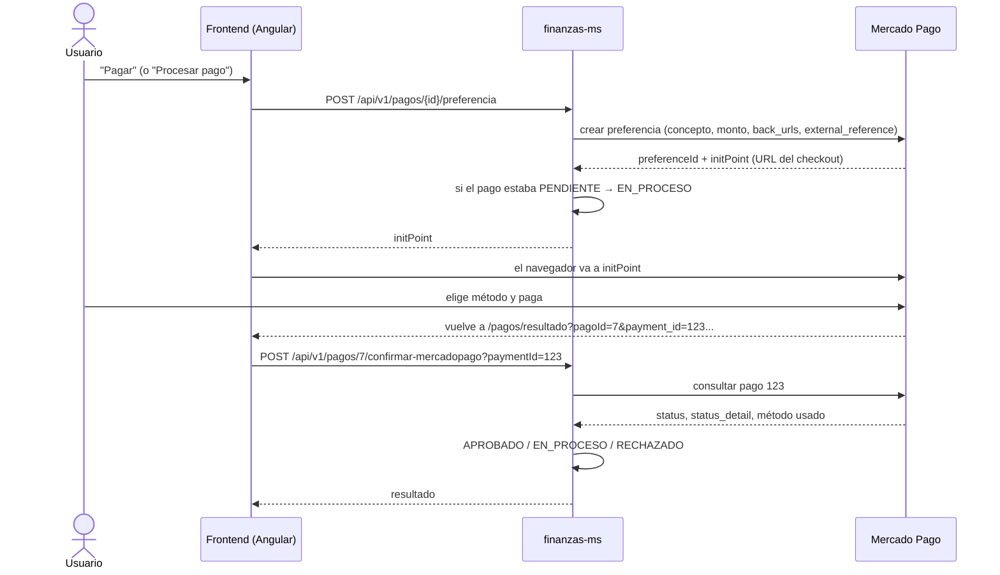

# Guía de estudio: cómo funciona Mercado Pago en LAMB

Esta guía explica **por qué** la integración está hecha así, no solo qué archivos tocar. Está pensada para poder explicarla en una revisión técnica. La referencia rápida (endpoints, tablas, archivos) está en [mercado-pago.md](mercado-pago.md).

---

## 1. La idea en una frase

LAMB **no cobra tarjetas**. LAMB le pide a Mercado Pago que cobre, manda al usuario a la página de Mercado Pago y, cuando vuelve, **le pregunta a Mercado Pago qué pasó realmente** y actualiza el pago.

Por eso LAMB nunca ve ni guarda números de tarjeta: eso lo hace Mercado Pago, que es quien tiene la certificación de seguridad para ello (PCI DSS).

---

## 2. Las piezas

| Pieza | Qué es | Dónde está |
|---|---|---|
| **Public Key** | Identifica la cuenta de cara al navegador. **No es secreta.** | `environment.ts` (frontend) y el yml |
| **Access Token** | Autoriza al backend a crear cobros y consultar pagos de la cuenta. **Es secreto**: quien lo tenga puede operar como esa cuenta. | yml de `finanzas-ms` |
| **SDK Java de Mercado Pago** | Librería oficial (`com.mercadopago:sdk-java`) que hace las llamadas HTTP a la API. | `pom.xml` de `finanzas-ms` |
| **Preferencia** | "Orden de cobro" que LAMB crea en Mercado Pago: qué se cobra, cuánto y a dónde volver. | `PasarelaPagoService.crearPreferencia` |
| **Checkout Pro** | La página de pago de Mercado Pago (tarjeta, Yape, agentes, banca). | En los servidores de Mercado Pago |
| **payment_id** | Id del pago real que Mercado Pago genera cuando el usuario paga. | Llega en la URL de vuelta |

### Credenciales de prueba vs. producción

- Las **de prueba** permiten simular cobros con tarjetas de prueba: no se mueve dinero.
- Las **de producción** cobran dinero real.
- Mercado Pago no deja mezclar mundos: una cuenta de prueba solo puede cobrarle a un comprador de prueba. Por eso, con el token anterior, salía el error *"Una de las partes con la que intentas hacer el pago es de prueba"*.

---

## 3. Cómo llegan las credenciales al código

```
lamb-finanzas-ms-dev.yml          (texto: mercadopago.access-token: ...)
        │  lo sirve
        ▼
lamb-config (Spring Cloud Config)
        │  finanzas-ms lo descarga al arrancar
        ▼
MercadoPagoProperties             (@ConfigurationProperties(prefix = "mercadopago"))
        │  se inyecta en
        ▼
MercadoPagoSdkConfig.init()       (@PostConstruct → MercadoPagoConfig.setAccessToken(...))
        │
        ▼
Todas las llamadas del SDK usan ese token
```

Puntos a saber explicar:

- **`@ConfigurationProperties`** convierte el bloque `mercadopago:` del yml en un objeto Java con `getAccessToken()`, `getBackUrlSuccess()`, etc. Así no hay `@Value` sueltos por el código.
- **`@PostConstruct`** ejecuta `init()` una sola vez, cuando Spring termina de crear el bean. El SDK guarda el token de forma global, así que basta configurarlo una vez al arrancar.
- **En producción** el yml de prod usa `${MP_ACCESS_TOKEN}` y `${MP_PUBLIC_KEY}`: el valor sale de variables de entorno del servidor, nunca del repositorio.
- **En desarrollo** el yml trae marcadores (`PEGA_AQUI_TU_ACCESS_TOKEN_DE_PRUEBA`). Cada integrante pega sus credenciales de prueba en su copia local.

---

## 4. El flujo completo, paso a paso



### Paso 1 — Crear la preferencia (`crearPreferencia`)

El backend arma tres cosas y se las manda a Mercado Pago:

1. **El ítem:** título = concepto del pago, cantidad 1, precio = monto.
2. **Las `back_urls`:** a dónde vuelve el navegador si el pago sale bien, queda pendiente o falla. Las tres apuntan a `/pagos/resultado`, y el backend les agrega `?pagoId=<id>`.
3. **`external_reference = "pago-<id>"`:** nuestro id dentro de Mercado Pago, para cruzar datos desde su panel.

Mercado Pago responde con un **`initPoint`**: la URL del checkout para ese cobro.

> **¿Por qué `pagoId` va en la URL de vuelta?** Mercado Pago agrega a la URL su `payment_id`, pero no nuestro `external_reference`. Sin `pagoId` la pantalla de resultado no sabría qué pago de LAMB confirmar.

### Paso 2 — El usuario paga en Mercado Pago

El frontend hace `window.location.href = initPoint`. A partir de aquí todo ocurre en la página de Mercado Pago: LAMB no ve la tarjeta.

### Paso 3 — Volver y confirmar (`confirmarPago`)

`/pagos/resultado` lee `pagoId` y `payment_id` de la URL y llama a `confirmar-mercadopago`. El backend **consulta el pago a Mercado Pago con el access token** (`PaymentClient().get(paymentId)`) y decide con lo que Mercado Pago responde.

> **Punto de seguridad clave:** el backend **no confía** en lo que dice la URL. Un usuario podría escribir a mano `?status=approved`. Por eso LAMB siempre pregunta a Mercado Pago con su token secreto, que el usuario no tiene.

### Paso 4 — Traducir el resultado (`aplicarResultado`)

| Mercado Pago responde | Estado en LAMB | Por qué |
|---|---|---|
| `approved` | `APROBADO` | Cobrado. |
| `pending` / `in_process` | `EN_PROCESO` | Ej.: pago en agente aún no realizado, o tarjeta en revisión. Se puede volver a confirmar después. |
| cualquier otro (`rejected`…) | `RECHAZADO` | No se cobró. |

También se guarda el **método real** que eligió el usuario (`metodoDesdeMercadoPago`): `yape` → YAPE; `credit_card`/`debit_card` → TARJETA; `ticket`/`atm` → EFECTIVO; `bank_transfer` → TRANSFERENCIA.

### Paso 5 — Avisar al resto del sistema

Si el pago queda `APROBADO`, `finanzas-ms` publica el evento **`pago.aceptado`** en Kafka (topic `pago-aceptado-eventos`). `matricula-ms` lo escucha y, si el pago tiene `matriculaId`, **confirma la matrícula**.

> **¿Por qué "después del commit"?** `PagoEventosProducer.publicarTrasCommit` espera a que la transacción de la base termine bien. Si se publicara antes y la base fallara, matrícula confirmaría una matrícula cuyo pago no quedó guardado.

Además se registra cada intento en `ingresos-pagos-ms` (log de pasarela). Si ese servicio está caído solo queda un `warn`: el pago no falla por eso.

---

## 5. Decisiones de diseño (y sus límites)

| Decisión | Motivo | Límite |
|---|---|---|
| **Checkout Pro** (redirigir) en vez de formulario propio de tarjeta | LAMB no maneja datos de tarjeta; Mercado Pago ofrece todos los métodos de Perú. | El usuario sale de LAMB durante el pago. |
| **Sin `auto_return`** | Mercado Pago lo exige con URL pública `https`; en `localhost` lo rechaza. | El usuario debe pulsar "Volver al sitio". |
| **Sin webhook en dev** | Mercado Pago no puede llamar a `localhost`. | Si el usuario cierra la pestaña antes de volver, el pago queda `EN_PROCESO`. Se arregla llamando a `confirmar-mercadopago` con el `payment_id` del panel. En producción se usaría `notification-url` con un dominio público. |
| **Cargo `PENDIENTE` → `EN_PROCESO` al pulsar Pagar** | `PENDIENTE` = "debe y nadie intentó pagar"; `EN_PROCESO` = "hay un intento en curso". Distinguirlos sirve para morosidad y anulación por impago. | — |
| **Orders API (`/pasarela`) existe pero no se usa** | Alternativa de cobro directo con token de tarjeta. | Marca fija (`master`) y 1 cuota; ninguna pantalla la usa. |

---

## 6. Manejo de errores

- El SDK lanza `MPApiException` cuando Mercado Pago responde con error (token inválido, datos mal formados) y `MPException` si no hay conexión.
- `PasarelaPagoService` captura ambas, deja un log con `component=pasarela` y lanza `BusinessRuleException`, que el manejador global convierte en una respuesta HTTP con el mensaje.
- Si Mercado Pago rechaza crear la preferencia, el cargo **sigue `PENDIENTE`**: el cambio de estado solo ocurre si la preferencia se creó bien.

---

## 7. Cómo probarlo

1. Pega tus credenciales de prueba (instrucciones en el comentario de `lamb-finanzas-ms-dev.yml`) y reinicia `lamb-config` y `finanzas-ms`.
2. En **Pagos**, pulsa **Pagar** en un cargo `PENDIENTE` (o crea uno con **Nuevo pago**).
3. En Mercado Pago, elige **Tarjeta** y usa una tarjeta de prueba: Mastercard `5031 7557 3453 0604`, CVV `123`, vencimiento `11/30`, titular **`APRO`** (aprobado) u **`OTHE`** (rechazado), documento `123456789`.
4. Pulsa "Volver al sitio" y revisa el estado en **Pagos**. Si era un cargo de matrícula, la matrícula pasa a `CONFIRMADA`.

---

## 8. Preguntas que te pueden hacer

**¿Dónde se guardan los datos de la tarjeta?**
En ningún lado de LAMB. La tarjeta se escribe en la página de Mercado Pago.

**¿Cómo sabe el sistema que el pago es real y no un usuario editando la URL?**
El backend consulta el pago a Mercado Pago con el access token (`PaymentClient().get(paymentId)`). El estado de la URL no se usa.

**¿Qué diferencia hay entre la public key y el access token?**
La public key identifica la cuenta y puede estar en el navegador. El access token autoriza operaciones; solo lo conoce el backend.

**¿Cómo se configura el token en producción?**
Con variables de entorno (`MP_ACCESS_TOKEN`, `MP_PUBLIC_KEY`) que el yml de prod lee con `${...}`. No está en el repositorio.

**¿Qué pasa si el usuario paga y cierra la pestaña?**
En local el pago queda `EN_PROCESO`, porque no hay webhook. Se puede confirmar a mano con el `payment_id`. En producción el webhook (`notification-url`) lo resolvería.

**¿Cómo se entera matrícula de que se pagó?**
Por el evento Kafka `pago.aceptado`, publicado después de guardar el pago. Matrícula lo consume y confirma la matrícula.

**¿Qué pasa si Kafka está caído?**
El pago queda `APROBADO` igual; el envío del evento falla y queda registrado en el log (`component=producer status=error`). La matrícula no se confirmaría sola. Es un punto de mejora (patrón *outbox*).

**¿Por qué no se usa el sandbox (`sandboxInitPoint`)?**
Con credenciales de usuario de prueba (`APP_USR`) Mercado Pago usa el `init_point` normal; la cuenta ya es de prueba.

---

## 9. Puntos débiles conocidos (mejor saberlos antes de que te los pregunten)

- **El login está desactivado:** `SecurityConfig` de `finanzas-ms` tiene `anyRequest().permitAll()`. Cualquiera puede llamar a la API de pagos. Hay que reactivar la autenticación antes de un uso real.
- **El access token anterior está en el historial de git** (commits `2cefa41` y `141a0da`). Aunque ya no está en el archivo, el dueño de esa cuenta debería regenerarlo.
- **Sin webhook**, la confirmación depende de que el usuario vuelva.
- **Reembolsar** solo cambia el estado en LAMB; no devuelve el dinero en Mercado Pago.
- **El monto de matrícula es fijo** (S/ 350, `MONTO_MATRICULA_PLACEHOLDER`).
