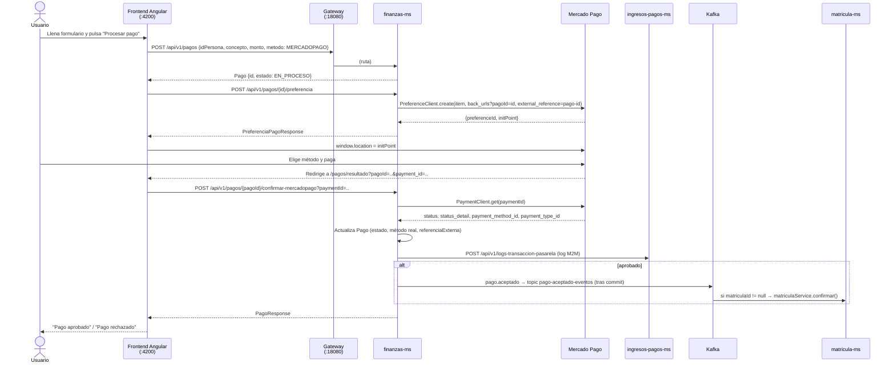

# Pagos con Mercado Pago

Contexto de cómo funciona hoy la integración con Mercado Pago en LAMB: qué ve el usuario, qué pasa por detrás, dónde está el código y qué falta. Sirve como referencia para el equipo y como contexto para retomar el trabajo con Claude.

> Estado a **2026-11-23** (commit `141a0da`). Si cambias el flujo, actualiza este archivo.

---

## 1. Resumen en una línea

El usuario registra un pago en LAMB → LAMB crea una **preferencia de Checkout Pro** → el navegador va a la página de **Mercado Pago**, donde el usuario elige tarjeta, Yape, PagoEfectivo, etc. → Mercado Pago lo devuelve a `/pagos/resultado` → LAMB **consulta el pago real** en Mercado Pago y lo marca `APROBADO`, `EN_PROCESO` o `RECHAZADO`.

---

## 2. Cómo lo usa un cliente (paso a paso)

1. Entra al frontend (`http://localhost:4200`) e inicia sesión con Keycloak.
2. Va a **Pagos → Nuevo pago** (`/pagos/nueva`).
3. Llena el formulario:
   - **Persona** que paga (lista de `personas-ms`).
   - **Concepto** (ej. "Constancia de estudios").
   - **Monto** en soles.
4. Pulsa **Procesar pago**. El botón cambia a "Redirigiendo a Mercado Pago...".
5. El navegador abre la página de **Mercado Pago (Checkout Pro)**. Ahí elige el método y paga.
6. Al terminar, Mercado Pago muestra un botón para volver al sitio, que lleva a `/pagos/resultado?pagoId=...&payment_id=...`. En local no hay retorno automático; ver §6.
7. La pantalla de resultado muestra:
   - **Pago aprobado. Referencia: ...** (verde), o
   - **Pago en_proceso / rechazado** (rojo).
8. En **Pagos** (`/pagos`) el pago aparece con el método real que se usó (TARJETA, YAPE, EFECTIVO...) y su estado.

---

## 3. Flujo técnico



### Estados del pago (`EstadoPago`)

| Estado | Cuándo |
|---|---|
| `PENDIENTE` | Cargo generado automáticamente al registrar una matrícula (todavía nadie lo intentó pagar). |
| `EN_PROCESO` | Pago creado desde el formulario, o Mercado Pago respondió `pending`/`in_process` (ej. PagoEfectivo aún no pagado en agente). Se puede volver a confirmar. |
| `APROBADO` | Mercado Pago respondió `approved` (Checkout Pro) o `processed`+`accredited` (Orders API). Dispara `pago.aceptado`. |
| `RECHAZADO` | Cualquier otro estado de Mercado Pago. |
| `REEMBOLSADO` | Reembolso manual desde la lista (`/reembolsar`, no llama a Mercado Pago). |

Solo se puede pagar con pasarela un pago en `EN_PROCESO`; si no, `BusinessRuleException`.

### Método real usado (`metodoDesdeMercadoPago`)

| Mercado Pago | `MetodoPago` en LAMB |
|---|---|
| `payment_method_id = yape` | `YAPE` |
| `credit_card`, `debit_card`, `prepaid_card` | `TARJETA` |
| `ticket`, `atm` (PagoEfectivo, agentes) | `EFECTIVO` |
| `bank_transfer` | `TRANSFERENCIA` |
| `account_money` u otro | `MERCADOPAGO` |

---

## 4. Endpoints (finanzas-ms, vía Gateway `:18080`)

| Método | Ruta | Para qué |
|---|---|---|
| `POST` | `/api/v1/pagos` | Crea el pago en `EN_PROCESO`. |
| `POST` | `/api/v1/pagos/{id}/preferencia` | Crea la preferencia de Checkout Pro. Devuelve `preferenceId`, `initPoint`, `sandboxInitPoint`. |
| `POST` | `/api/v1/pagos/{id}/confirmar-mercadopago?paymentId=X` | Consulta el pago en Mercado Pago y aplica el resultado. |
| `POST` | `/api/v1/pagos/{id}/pasarela` | **Alternativa**: cobro directo con Orders API. Body `{cardToken, payerEmail}`. Ver §7. |
| `POST` | `/api/v1/pagos/{id}/aceptar` / `rechazar` | Aprobación/rechazo **manual** (ADMIN/COORDINADOR desde la lista). `aceptar` también publica `pago.aceptado`. |
| `POST` | `/api/v1/pagos/{id}/reembolsar` | Marca `REEMBOLSADO` (solo en LAMB). |

---

## 5. Dónde está el código

**Backend — `services/lamb-finanzas-ms/src/main/java/pe/edu/upeu/lamb/finanzas/`**

| Archivo | Rol |
|---|---|
| `service/PasarelaPagoService.java` | Toda la lógica de Mercado Pago: `crearPreferencia`, `confirmarPago`, `pagarConTarjeta`, mapeo de estados y métodos, log y evento. |
| `controller/PagoController.java` | Endpoints de §4. |
| `config/MercadoPagoProperties.java` | Propiedades `mercadopago.*`. |
| `config/MercadoPagoSdkConfig.java` | Inicializa el SDK con el `access-token` al arrancar. |
| `client/IngresosPagosPasarelaClient.java` | Registra cada intento en `ingresos-pagos-ms` (`LogTransaccionPasarela`). Si falla, solo hace `warn`. |
| `messaging/PagoEventosProducer.java` | Publica `pago.aceptado` **después del commit**. |
| `dto/PreferenciaPagoResponse.java` | Respuesta de la preferencia. |

**Frontend — `clients/lamb-frontend/src/`**

| Archivo | Rol |
|---|---|
| `app/features/pagos/pago-form.ts` / `.html` | Formulario "Nuevo pago": `procesar` → `crearPreferencia` → redirige a `initPoint`. |
| `app/features/pagos/pago-resultado.component.ts` | Pantalla de retorno: lee `pagoId` y `payment_id` y llama a `confirmar-mercadopago`. |
| `app/features/pagos/pago-service.ts` | Llamadas HTTP. |
| `app/app.routes.ts` | Rutas `/pagos`, `/pagos/nueva`, `/pagos/resultado`. |
| `environments/environment.ts` | `mercadoPago.publicKey`. |
| `index.html` | Carga el SDK JS `https://sdk.mercadopago.com/js/v2`. |

---

## 6. Configuración

Archivo: `infra/lamb-config/config-repo/lamb-finanzas-ms-dev.yml`

```yaml
mercadopago:
  public-key: APP_USR-...        # pública, también en environment.ts del frontend
  access-token: APP_USR-...      # SECRETO: cobra y consulta pagos de la cuenta
  back-url-success: http://localhost:4200/pagos/resultado
  back-url-pending: http://localhost:4200/pagos/resultado
  back-url-failure: http://localhost:4200/pagos/resultado
  notification-url: http://localhost:4200/
```

- Las tres `back-url` apuntan a la misma pantalla; el backend les agrega `?pagoId=<id>`, porque Mercado Pago no reenvía el `external_reference` como parámetro.
- **`auto_return` no se usa**: Mercado Pago lo exige con una URL pública `https`, y en localhost la rechaza. El usuario vuelve pulsando el botón de Mercado Pago.
- **Webhook (`notification-url`)**: en local Mercado Pago no puede llegar a `localhost`, así que **la confirmación depende de que el usuario vuelva a `/pagos/resultado`**. Si cierra la pestaña antes, el pago queda `EN_PROCESO` en LAMB aunque se haya cobrado en Mercado Pago. En ese caso se puede llamar a mano a `confirmar-mercadopago` con el `payment_id` del panel de Mercado Pago.
- Las credenciales son de **usuario de prueba** (`APP_USR`): por eso se usa `initPoint` y no `sandboxInitPoint`.
- ⚠️ El `access-token` real está commiteado en el repositorio privado `JoaHasss/Lamb-UPEU` por decisión del equipo. Si el repositorio se hace público o se suman colaboradores externos, **genera un token nuevo** en el panel de Mercado Pago.

---

## 7. Pendientes y cosas a saber

- **Checkout Pro puede fallar al cobrar con esta cuenta**: un comentario en `pago-service.ts` registra que la página de Mercado Pago terminaba en `/fatal/`. Si vuelve a pasar, revisar la configuración de la cuenta o la aplicación en el panel de Mercado Pago (no es un problema de código).
- **Orders API (`/pasarela`) existe pero ningún pantalla la usa todavía.** Necesitaría un formulario de tarjeta con el SDK JS (`MercadoPago(publicKey).createCardToken(...)`) que envíe `cardToken` y `payerEmail`. Además, en el backend la marca está fija: `id("master")` y `installments(1)`, así que solo funcionaría con Mastercard en una cuota.
- La antigua Payments API (`/v1/payments`) se reemplazó por Orders API porque la cuenta la rechaza con "Unauthorized use of live credentials".
- **Cobros de matrícula**: al registrar una matrícula, `finanzas-ms` crea un cargo `PENDIENTE` de **S/ 350.00** (`MONTO_MATRICULA_PLACEHOLDER`, monto fijo provisional). La lista de pagos **todavía no tiene botón para pagar un `PENDIENTE` con Mercado Pago**; solo ADMIN/COORDINADOR pueden aceptar/rechazar los `EN_PROCESO` a mano. Para cerrar el circuito falta: pasar el cargo a `EN_PROCESO` y reutilizar `crearPreferencia`.
- Cuando un pago con `matriculaId` queda `APROBADO`, `matricula-ms` escucha `pago.aceptado` (topic `pago-aceptado-eventos`) y **confirma la matrícula**.
- `ingresos-pagos-ms` tiene un consumidor **temporal** de `matricula.registrada` que publica `pago.validado` siempre como `VALIDADO` para que `lms-ms` habilite el curso en la demo. No depende de Mercado Pago; es el lugar a cambiar cuando exista la regla real.
- Reembolsos: `/reembolsar` solo cambia el estado en LAMB; **no devuelve el dinero en Mercado Pago**.

---

## 8. Probar en local

1. Levantar la infraestructura y los servicios (orquestador DB-Detector o los scripts de `scripts/`). Como mínimo: Kafka, Keycloak, config, gateway, `finanzas-ms`, `ingresos-pagos-ms`, `personas-ms` y el frontend.
2. Abrir `http://localhost:4200`, iniciar sesión e ir a **Pagos → Nuevo pago**.
3. Pagar en Mercado Pago con una [tarjeta de prueba](https://www.mercadopago.com.pe/developers/es/docs/checkout-pro/additional-content/your-integrations/test/cards) (titular `APRO` = aprobado, `OTHE` = rechazado).
4. Volver con el botón de Mercado Pago y verificar el estado en `/pagos`.
5. Logs útiles en `finanzas-ms`: buscar `component=pasarela` (errores de Mercado Pago con `httpStatus` y `motivo`) y `component=producer` (evento `pago.aceptado` publicado).
